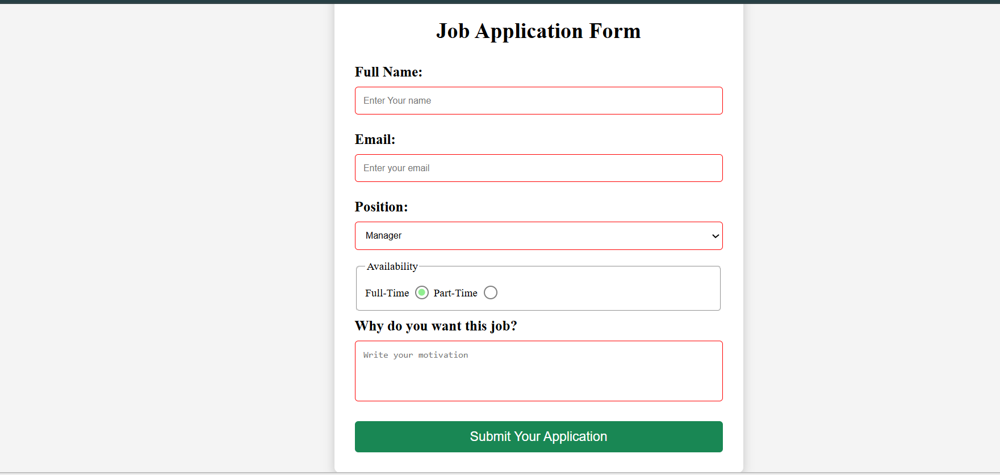

# Job Application Form

## Description

A responsive and modern **Job Application Form** built using HTML5 and CSS3. The project demonstrates the use of semantic HTML, custom-styled radio buttons, form accessibility, and responsive layout techniques. It also includes smooth hover and focus effects to improver user experience.

## Technologies Used

- HTML5
- CSS3
- Git
- Github

## Preview



## Features

- Responsive form layout
- Semantic HTML structure
- Custom radio button design
- Smooth hover and focus animations
- Accessible form controls
- Clean and modern user interface

## Installation

1. Clone the repository

```bash
git clone https://github.com/hitechLtd/front-end-projects 
```

2. Navigate into the project directory

```bash
cd job-application-form
```

3. Open `index.html` in your browser.

## What I learned 

Working on this project helped me strengthen my understanding of:

- Writing semantic and accessible HTML.
- Structuring forms using labels, fieldsets, legends, and form controls.
- Grouping radion buttons using the same `name` attribute so that only one option is chosen at a time.
Using the universal selector with `box-sizing: border-box` to create predictable layouts and prevent elements from overflowing.
- Styling form controls using pseudo-classes such as `:focus`, `:hover`, and `:checked`.
- Creating custom radio buttons using pseudo-elements (`::before`).
- Applying `box-shadow`, `border-radius`, and transitions to build modern looking interface;
- Building responsive layouts using flexible widths and `max-width`.
- Organizing CSS into reusable and maintainable selectors.

## Future Improvements

- Add form validation with JavaScript.
- Display success and error messages after submission.
- Improve accessibility with ARIA attributes.
- Connect the form to a backend service for handling submissions.

## Author

**Bright Chimwaza**

Github: https://github.com/hitechLtd
